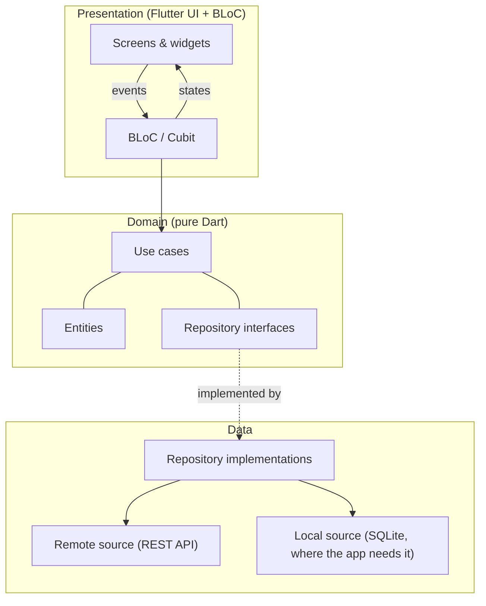

# Theeraphat Srimontha — Junior Mobile Developer Portfolio

<div align="center">

  <a href="https://theeraphat-portfolio.vercel.app/">
    
  </a>
  <a href="mailto:theeraphat.sm@gmail.com">
    
  </a>
  <a href="https://github.com/Theeraphat-S">
    
  </a>

  <br />
  <br />

  
  
  
  
  
  

</div>

A bilingual (Thai / English) portfolio for a junior mobile developer who works mainly with **Flutter, Dart and BLoC**. Instead of screenshots, each project is told as a scroll-led story: a simulated phone shows the app's state at each step, and an event log underneath shows what the BLoC layer did.

**[Open the live site →](https://theeraphat-portfolio.vercel.app/)**

---

## What's on the site

- **Scroll-led case studies.** Each project walks through three beats: _intake → logic → persistence_. On desktop the phone stays pinned while the beats scroll past; each beat change updates the phone screen and adds one event to the log under it.
- **DevTools drawer.** Opens from the phone dock: the event log with payloads, a Dart/BLoC code sample for the beat, and notes on keeping rebuilds inside the 16.6 ms frame budget.
- **Thai / English with no layout shift.** Both languages are laid out in the same space, so switching language never moves the page.
- **Accessible by default.** Skip link, keyboard paths through the chapter menu, modal and drawer (Esc closes and returns focus), a 2px focus outline everywhere, 44px touch targets on phones, and a static, complete layout when the reader prefers reduced motion.

## Projects

### NCDs Risk Screening App — senior capstone, 2025

`Flutter` · `Dart` · `BLoC` · `REST API` · `MySQL`

- Risk scoring for diabetes, hypertension, heart disease and obesity runs on the device in BLoC, so scoring doesn't wait on the network.
- Screening records are submitted through a REST API to MySQL, with a one-touch PDF summary for village health volunteers (VHVs).
- Field-tested with VHVs: screening time went from 10–15 min to 3–5 min per patient.

### Pinto app — internship at Fakduay Logistics & Digital Platform, 2026

`Flutter` · `Dart` · `WebView` · `Profile API` · `Agile / Scrum`

- Embedded the existing web menus in a WebView inside the Flutter app, with state management keeping the native cart in step.
- Built Chat Streaks: consecutive chat days unlock rewards on check-in, and streak points are written through the Profile API.
- Features shipped to the production app.

### Retail POS module — internship at Fakduay Logistics & Digital Platform, 2026

`Flutter` · `Dart` · `SQLite` · `REST API`

- Reactive cart state recalculates totals, tax and item counts without waiting on the server.
- When the network drops, transactions go into a local SQLite queue so checkout continues.
- On reconnect the queue replays with client-generated transaction UUIDs, so the server drops duplicates.

## How I structure Flutter apps



## Skills

| Area                | Tools                                                                       |
| :------------------ | :-------------------------------------------------------------------------- |
| Mobile              | Flutter, Dart, BLoC / Cubit, Provider, Clean Architecture, Android Studio   |
| Languages & web     | Java, JavaScript / TypeScript, HTML5 & CSS3, Go, React, Spring Boot         |
| Data & tooling      | MySQL, Oracle Database, REST API & Postman, Git & GitHub, VS Code & Eclipse |
| Teaching & teamwork | Teaching assistant for 4 semesters (2023–2025), Agile / Scrum               |

---

## About this codebase

| Layer     | Choice                                                                               |
| :-------- | :----------------------------------------------------------------------------------- |
| Framework | React 19, TypeScript, Vite 6                                                         |
| Styling   | Tailwind CSS v4 with CSS-variable tokens; Outfit, IBM Plex Sans Thai, JetBrains Mono |
| Motion    | Motion (`motion/react`) inside `LazyMotion`, Lenis smooth scroll                     |
| Icons     | Lucide                                                                               |

```
src/
├── components/
│   ├── mobile-mockup/   # Simulated phone, app screens, event dock, DevTools drawer
│   └── sections/        # Hero, About, Projects (case studies + modal), Skills, Experience, Contact
├── context/             # Language and story-scroll state
├── data/                # All copy, facts and figures (single source of truth)
├── hooks/  lib/         # Scroll scrubbing, motion tokens, helpers
└── types/
```

All copy lives in `src/data/`, never in components. Project and design context for contributors (and coding agents) is in:

- [`AGENTS.md`](AGENTS.md) — working rules and the verification checklist
- [`PRODUCT.md`](PRODUCT.md) — audience, positioning and what may be claimed
- [`DESIGN.md`](DESIGN.md) — palette, type, components and motion rules
- [`docs/adr/`](docs/adr/) — architecture decisions, including the scroll-driven story ([ADR 0006](docs/adr/0006-scroll-driven-story.md))

## Run it locally

```bash
git clone https://github.com/Theeraphat-S/portfolio-web.git
cd portfolio-web
npm install
npm run dev
```

| Command                | What it does                                |
| :--------------------- | :------------------------------------------ |
| `npm run dev`          | Start the Vite dev server                   |
| `npm run build`        | Type-check and build for production         |
| `npm run preview`      | Serve the production build locally          |
| `npm run lint`         | Run ESLint (`lint:fix` to auto-fix)         |
| `npm run format:check` | Check Prettier formatting (`format` to fix) |

Before opening a pull request, run all four checks:

```bash
npx tsc --noEmit
npm run lint
npm run format:check
npm run build
```

## Contact

**Theeraphat Srimontha (Oven)** — Junior Mobile Developer (Flutter & Dart)<br />
B.Sc. Information Technology, Maejo University (2022–2026)<br />
Chiang Mai, Thailand · open to onsite, hybrid or remote roles

[theeraphat.sm@gmail.com](mailto:theeraphat.sm@gmail.com) · [064-770-0893](tel:0647700893) · [github.com/Theeraphat-S](https://github.com/Theeraphat-S)
